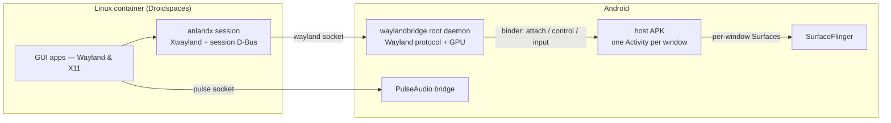

# Anland — a Wayland host for Android

**English** | [简体中文](README_CN.md)

Anland runs the graphical Linux apps of a container on a **rooted Android** device and shows each of them as a **native Android window** — its own entry in the app switcher, its own Surface, its own soft-keyboard focus. There is no virtual screen and no mirroring: every app gets a real window, and Android's own compositor keeps drawing the screen.

It ships as a SukiSU/KernelSU module (`anland-awl`): a root daemon, a host APK, the session inside the container, and an audio bridge. The companion launcher [anland-shell](https://github.com/SuperTurtleDev/anland-shell) manages the containers and starts the apps.

> [!IMPORTANT]
> **Branch status.** `main` is the active development branch — the refactored 6.x
> architecture. As a consequence of the rewrite it does not yet reach the feature
> completeness of 5.x: if you want stability and the full desktop experience, use
> the [`legacy`](https://github.com/SuperTurtleDev/anland/tree/legacy) branch
> (5.x) instead. 5.x stays in maintenance until 6.x catches up with the 5.x
> feature set (complete desktop, virtual keyboard, accessibility, …).
> Maintenance is bug fixes only — and only functional bugs that affect usage;
> intermittent glitches that a restart of the consumer app clears are out of
> scope.

**Why the rewrite?** 5.x exchanged frames over a private display protocol (the
"Anland Display Protocol"): every compositor — KWin, Weston, … — needed its own
adaptation backend written against that protocol, and each of those had to be
maintained separately. The 6.x refactor makes Wayland itself the frame-exchange
protocol, so stock compositors work unmodified and only the host side needs
maintaining.

## Why it is not a standard compositor

A standard Wayland compositor — Weston, Sway, a desktop session — takes over a machine's display: it owns the whole screen, composites every client into one output, reads input from evdev, and clients reach it through the `wayland-0` socket. On a phone that model degrades into "one fullscreen remote-desktop window". Anland keeps the protocol half of a compositor and replaces the display half with Android itself:

| | Standard compositor | Anland |
|---|---|---|
| Screen | Owns the display, composites everything into one output | Owns no display — Android's SurfaceFlinger keeps compositing |
| Windows | Internal window management inside a single output | Every `xdg_toplevel` becomes one real Android window (its own Activity and Surface) |
| Connection | A `wayland-0` unix socket file | No socket file — connections are fds passed over Android binder |
| Client identity | All clients are the same session user | Every client connects with its own uid; windows are owned per app |
| Input | evdev/libinput from DRM devices | Each window's Android touch/key/IME events, translated to Wayland |
| Lifecycle | A user session process | A root daemon in its own SELinux domain — not an app uid, so OEM "battery optimization" cannot freeze it |

What that design buys you:

- **Linux windows are first-class Android windows.** They appear in the app switcher, split-screen and behave like ordinary app windows — each with its own focus and its own IME state, candidates following the cursor.
- **Hidden windows park their clients.** With no Android surface attached, the daemon stops draining that window's buffers, so a minimized Linux app neither spins nor burns GPU frames.
- **Foreground apps are scheduled like foreground apps.** While a window is attached, its client's whole process tree is moved into Android's top-app cgroups — the Linux app in front of you is scheduled like any foreground Android app, not like a background daemon.
- **Sound included.** A PulseAudio bridge plays the container's audio through Android's own audio stack.
- **X11 apps included.** The in-container session runs a patched rootless Xwayland, so X11 apps show up as windows the same way Wayland apps do.
- **Real-device fixes the stock stack lacks.** A bubblewrap that survives KernelSU+SuSFS fake mount ids, and an Xwayland that does accelerated GL on Adreno GPUs (kgsl/turnip) — see `patches/`.
- **Any Android app can join in.** The `libawl` client library lets a third-party app connect over binder and host its own Wayland windows, scoped to that app's uid.

## How it fits together



The pieces:

- **`waylandbridge`** — the daemon: a single statically-linked ELF holding both the Wayland protocol side and the GPU renderer. It renders each window's frames directly into the Surface of that window's Android Activity.
- **Host APK (`com.anlandnext`)** — spawns one Activity per window, feeds it input, and provides the window list and settings UI.
- **`libawl`** — the client library (AAR) that third-party apps embed to host their own windows.
- **anlandx** — the session inside the container: links the daemon's socket, runs rootless Xwayland with a small X window manager, and publishes the app environment.
- **pulse** — PulseAudio for Android (OpenSL ES / AAudio sinks) so container apps have sound.
- **module** — the SukiSU/KernelSU packaging: boot service, SELinux domain, contexts generated at flash time from the device's live system files.

## Rendering backends: SC and EGL

The daemon composites each window through one of two backends, selected by
`sc_enabled` in the daemon config (`/data/adb/modules/anland-awl/config.json`,
default `1`; applied when a window attaches):

- **SC (SurfaceControl) — efficient, low overhead, scanout direct.** Every
  wayland layer becomes a SurfaceControl sibling and SurfaceFlinger/HWC does the
  compositing — the daemon composites nothing, and a client's dma-buf can be
  scanned out zero-copy on an HWC plane. The trade-off: surface *movement*
  responds more slowly, since positions land through SF transactions. Best for
  content whose surfaces mostly sit still — games.
- **EGL (GL renderer) — smooth movement, higher GPU usage.** A per-window GPU
  compositor samples every layer into one buffer and presents it through
  eglSwapBuffers. Surface movement is smooth, at the price of a GPU composite
  every frame. Best for scrolling content — web browsing.

## Requirements

- A rooted arm64 device (SukiSU or KernelSU)
- A Droidspaces Linux container
- The host APK installed — windows attach through it, and audio requires it

## Install

1. Get the three artifacts: `build/module/anland-awl.zip`, `build/anland-wayland.apk`, `build/anlandx.tar.gz` — build them (below) or take them from CI.
2. Flash the zip in your root manager and reboot. The daemon starts at boot (log: `/data/local/tmp/awl_daemon.log`).
3. Install `anland-wayland.apk`.
4. Inside the container, set up the session:

   ```sh
   tar xzf anlandx.tar.gz && bash anlandx/setupanlandx.sh
   ```

5. Manage containers and launch apps with [anland-shell](https://github.com/SuperTurtleDev/anland-shell).

## Build

Linux host with JDK 17, an Android SDK (`ANDROID_HOME` and `JAVA_HOME` set; missing pieces are auto-installed), plus meson/ninja/patch for the audio part.

```sh
git submodule update --init --recursive
make        # waylandbridge + host APK + module zip + anlandx tarball
```

Two things live outside the repo and are not auto-installed — a
`wayland-scanner` built from the pinned fork, and a libffi release tarball
overlaid on the submodule (the checkout ships no generated `configure`). Steps,
proxies and troubleshooting are in [docs/build.md](docs/build.md)
(中文: [docs/build.zh.md](docs/build.zh.md)).

CI builds every push/PR and uploads the artifacts; a `v*` tag publishes a
release with the APK, the AAR, the module zip and the session tarball.

## VR: SteamVR in an XR window

The VR support does not hand the display over to the container. `vrcompositor`
keeps drawing into an ordinary window; the daemon recognises it, bends the image
into the two eyes (per-eye pre-distortion plus timewarp against the phone's IMU)
while it blits that window out, and publishes head pose and gamepad state as
small seqlock files. Inside the container an OpenVR server driver
(`xr/driver`) and a Vulkan implicit layer (`xr/layer`) make SteamVR believe it
owns a windowed HMD:

- `sc_enabled = 0` and `xr_enabled = 1` in the daemon config,
- `xr/build.sh` inside the container, then `xr/anland-steamvr install` and
  `xr/anland-steamvr start`.

Head tracking is 3DoF (orientation only) but it does not go through the throttled
fused pose Android hands a 2D window: the daemon is root anyway, so it reads the
gyroscope and accelerometer itself (`xr_imu`, up to 1 kHz). A 6DoF source can
take the pose over through the `anland-xr-pose-ext` file, and `xr_predict`
extrapolates the newest sample to hide pose latency. The two controllers are a
gamepad mapped onto the standard OpenVR profile (they accept real poses if
something writes them), and the distortion happens on the host — see
[docs/vr.md](docs/vr.md) (中文: [docs/vr.zh.md](docs/vr.zh.md)) for the geometry,
the config keys and what is left of the limits.
Every knob (eye layout, refresh, per-eye size, FOV, IPD, render scale,
distortion, chromatic aberration, pose prediction, sensor source and rate, the
title that selects the window) lives in **Window Settings → VR**, with a Quest 3S
preset; changes reach a running session without restarting anything.

## Desktop: a nested compositor in a window

A desktop compositor (KWin, Weston, Sway, Mutter) is just another Wayland
client, so it can run nested inside an anland window: it asks the host for one
surface and draws a whole desktop into it. The 5.x line solved this differently,
with a `backend-anland` plugin re-implemented for each KWin release; 6.x instead
makes the host a compositor its clients can trust:

- `wl_output` v4 (+ `zxdg_output_manager_v1`) with the real panel size, name and
  refresh,
- `wp_presentation` so a client compositor learns *when* the frame it submitted
  reached the screen instead of assuming it, which is what KDE's mailbox
  submission model needs to stop queueing stale frames,
- `zwp_linux_dmabuf_v1` v3 with the format/modifier list the host can import
  (`LINEAR`), and the shm path for when it cannot,
- a "desktop session" mark (`desktop_mode` + `desktop_match` in the daemon
  config): the matched toplevel gets `FULLSCREEN|MAXIMIZED` in every configure
  and is pinned to the panel, so the compositor treats the host as a monitor
  rather than a floating window manager.

```sh
sc_enabled=0, desktop_mode=1        # /data/adb/modules/anland-awl/config.json
bash anlandx/anland-session.sh &
bash anlandx/anland-desktop         # auto-detects kwin_wayland > weston > sway > mutter
```

[docs/desktop.md](docs/desktop.md) covers the advertised protocols, the
launcher, verification (`wayland-info`, `logcat -s waylandbridge`) and the
limits — no DRM/KMS, one desktop at a time, and a note that a full Plasma
session has not been device-tested yet. Both keys are in
**Window Settings → Desktop** as well. 中文: [docs/desktop.zh.md](docs/desktop.zh.md).

Every document under `docs/` has a Chinese twin next to it (`*.zh.md`); if you
change one, change both.

## Related projects

- [anland-shell](https://github.com/SuperTurtleDev/anland-shell) — the launcher: container management and the app grid that drives all of this.

## License

GPL-3.0. Bundled third-party components (libwayland, PulseAudio, bubblewrap, Xwayland, …) keep their own licenses.
