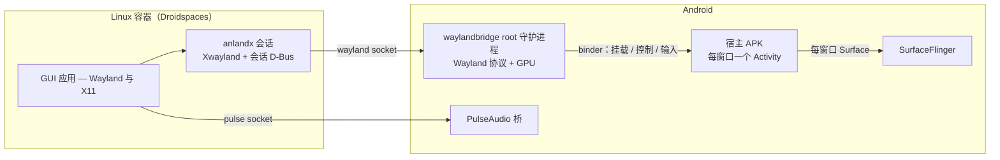

# Anland — Android 上的 Wayland 宿主

**简体中文** | [English](README.md)

Anland 在 **已 root 的 Android** 设备上运行 Linux 容器里的图形应用，并把每一个应用显示为一个**原生 Android 窗口**——在最近任务里有自己的卡片、有自己的 Surface、有自己的输入法焦点。没有虚拟屏幕，也没有画面镜像：每个应用拿到一个真正的窗口，屏幕仍由 Android 自己的合成器绘制。

它以 SukiSU/KernelSU 模块（`anland-awl`）的形式发布：一个 root 守护进程、一个宿主 APK、容器内的会话，以及音频桥。配套启动器 [anland-shell](https://github.com/SuperTurtleDev/anland-shell) 负责管理容器和启动应用。

> [!IMPORTANT]
> **分支状态。** `main` 是活跃开发分支（重构后的 6.x 架构）。由于重构，功能尚不及
> 5.x 完整：追求稳定和完整桌面体验请使用
> [`legacy`](https://github.com/SuperTurtleDev/anland/tree/legacy) 分支（5.x）。
> 5.x 会持续维护，直到 6.x 补齐 5.x 的功能（完整桌面、虚拟键盘、无障碍等）。
> 维护仅限 bug 修复——且只接受影响使用的功能性 bug；重启 consumer app 即可解决的
> 概率性小问题不在维护范围内。

**为什么重构？** 5.x 用一套私有显示协议（"Anland Display Protocol"）交换帧：每个合成器
——KWin、Weston……——都要针对该协议单独维护一套适配后端，维护成本高。6.x 的重构把帧
交换协议标准化为 Wayland 本身，原生合成器无需改动即可接入，只有宿主一侧需要维护。

## 它和标准合成器有什么不同

标准的 Wayland 合成器——Weston、Sway、桌面会话——接管整台机器的显示：独占整个屏幕、把所有客户端合成到一个输出、从 evdev 读取输入，客户端通过 `wayland-0` socket 连接。这套模型放到手机上就会退化成"一个全屏的远程桌面窗口"。Anland 保留了合成器的协议那一半，把显示那一半交还给 Android：

| | 标准合成器 | Anland |
|---|---|---|
| 屏幕 | 独占显示，把一切合成到单一输出 | 不持有任何显示——SurfaceFlinger 继续负责合成 |
| 窗口 | 在单一输出内部做窗口管理 | 每个 `xdg_toplevel` 变成一个真正的 Android 窗口（独立的 Activity 和 Surface） |
| 连接 | `wayland-0` unix socket 文件 | 没有 socket 文件——连接通过 Android binder 传递 fd |
| 客户端身份 | 所有客户端都是同一个会话用户 | 每个客户端以自己的 uid 连接；窗口按应用归属 |
| 输入 | 来自 DRM 设备的 evdev/libinput | 每个窗口的 Android 触摸/按键/输入法事件，翻译成 Wayland 事件 |
| 生命周期 | 一个用户会话进程 | 自有 SELinux 域的 root 守护进程——不是 app uid，厂商"省电优化"冻结不了它 |

这套设计带来的东西：

- **Linux 窗口是一等公民的 Android 窗口。** 出现在最近任务里、支持分屏、表现和普通应用窗口一致——各自持有焦点和输入法状态，候选框跟随光标。
- **隐藏的窗口会让客户端挂起。** 没有 Android surface 挂载时，守护进程停止消费该窗口的缓冲区，最小化的 Linux 应用既不空转也不烧 GPU 帧。
- **前台应用按前台调度。** 窗口挂载期间，客户端的整个进程树会被移入 Android 的 top-app cgroup——眼前的 Linux 应用按前台 Android 应用调度，而不是像后台守护进程那样被限速。
- **自带声音。** PulseAudio 桥把容器的音频经由 Android 自己的音频栈播放出来。
- **自带 X11。** 容器内会话运行打过补丁的 rootless Xwayland，X11 应用和 Wayland 应用一样以窗口形式出现。
- **真机问题真修复。** 能在 KernelSU+SuSFS 伪挂载 id 下存活的 bubblewrap，以及在 Adreno GPU（kgsl/turnip）上做硬件加速 GL 的 Xwayland——见 `patches/`。
- **任何 Android 应用都能加入。** 第三方应用通过 `libawl` 客户端库经 binder 连接，托管自己的 Wayland 窗口，权限按该应用的 uid 隔离。

## 组合起来是什么样



各组成部分：

- **`waylandbridge`**——守护进程：单个静态链接的 ELF，同时容纳 Wayland 协议侧和 GPU 渲染器。它把每个窗口的帧直接渲染进该窗口 Android Activity 的 Surface。
- **宿主 APK（`com.anlandnext`）**——每个窗口启动一个 Activity、喂入输入事件，并提供窗口列表和设置界面。
- **`libawl`**——客户端库（AAR），第三方应用嵌入后即可托管自己的窗口。
- **anlandx**——容器内的会话：链接守护进程的 socket、运行 rootless Xwayland 和一个小型 X 窗口管理器、发布应用环境。
- **pulse**——Android 版 PulseAudio（OpenSL ES / AAudio 输出），让容器应用有声音。
- **module**——SukiSU/KernelSU 模块封装：开机服务、SELinux 域、刷入时从设备活系统文件生成 contexts。

## 渲染后端：SC 与 EGL

守护进程以两种后端之一合成每个窗口，由守护进程配置（`/data/adb/modules/anland-awl/config.json` 的
`sc_enabled`，默认 `1`，窗口挂载时生效）决定：

- **SC（SurfaceControl）——高效、低占用、扫描直出。** 每个 wayland 图层成为一个
  SurfaceControl 兄弟层，由 SurfaceFlinger/HWC 负责合成——守护进程自己不合成，客户端的
  dma-buf 可以零拷贝直上 HWC 平面。代价是 surface *移动* 响应较慢：位置要经由 SF 事务
  落地。适合 surface 基本不动的场景——游戏。
- **EGL（GL 渲染器）——移动平滑、GPU 占用高。** 每窗口一个 GPU 合成器，把所有图层
  采样进一个缓冲区，经 eglSwapBuffers 呈现。surface 移动平滑，代价是每帧一次 GPU
  合成。适合滚动内容——网页浏览。

## 环境要求

- 已 root 的 arm64 设备（SukiSU 或 KernelSU）
- 一个 Droidspaces Linux 容器
- 已安装宿主 APK——窗口经由它挂载，音频也依赖它

## 安装

1. 取得三个产物：`build/module/anland-awl.zip`、`build/anland-wayland.apk`、`build/anlandx.tar.gz`——自己构建（见下）或从 CI 取。
2. 在 root 管理器里刷入 zip 并重启。守护进程开机自启（日志：`/data/local/tmp/awl_daemon.log`）。
3. 安装 `anland-wayland.apk`。
4. 在容器内搭建会话：

   ```sh
   tar xzf anlandx.tar.gz && bash anlandx/setupanlandx.sh
   ```

5. 用 [anland-shell](https://github.com/SuperTurtleDev/anland-shell) 管理容器、启动应用。

## 构建

需要 Linux 主机、JDK 17、Android SDK（设置 `ANDROID_HOME` 与 `JAVA_HOME`；缺失组件自动安装），音频部分另需 meson/ninja/patch。

```sh
git submodule update --init --recursive
make        # waylandbridge + 宿主 APK + 模块 zip + anlandx 压缩包
```

有两样东西不在仓库里、也不会自动安装：一是用仓库锁定的 wayland fork 自己构建的
`wayland-scanner`，二是覆盖到 submodule 上的 libffi release tarball（git checkout
里没有生成的 `configure`）。完整步骤、代理设置和常见错误见
[docs/build.md](docs/build.md)。

CI 会在每次 push/PR 时构建并上传产物；打 `v*` 标签则会发布 Release，附带 APK、
AAR、模块 zip 和会话压缩包。

## VR：在 XR 窗口里跑 SteamVR

VR 支持不把显示交给容器。`vrcompositor` 依然画进一个普通窗口；守护进程认出这个窗口，在把窗口画面贴出去的同时把图像弯成左右眼（每眼预畸变 + 用手机 IMU 做时域重投影），并把头部位姿和手柄状态写成小段 seqlock 文件给容器。容器里由 OpenVR 驱动（`xr/driver`）和 Vulkan 隐式层（`xr/layer`）让 SteamVR 相信它拥有一台窗口化的头显：

- 守护进程配置里 `sc_enabled = 0`、`xr_enabled = 1`；
- 容器里跑 `xr/build.sh`，再 `xr/anland-steamvr install`、`xr/anland-steamvr start`。

头部追踪是 3DoF（只有朝向），两个手柄其实是一个手柄映射到标准 OpenVR 配置，畸变在宿主侧做——几何、配置项与限制见 [docs/vr.md](docs/vr.md)。

## 相关项目

- [anland-shell](https://github.com/SuperTurtleDev/anland-shell)——启动器：容器管理与启动这一切的应用格子。

## 许可证

GPL-3.0。随附的第三方组件（libwayland、PulseAudio、bubblewrap、Xwayland 等）保留各自许可证。
